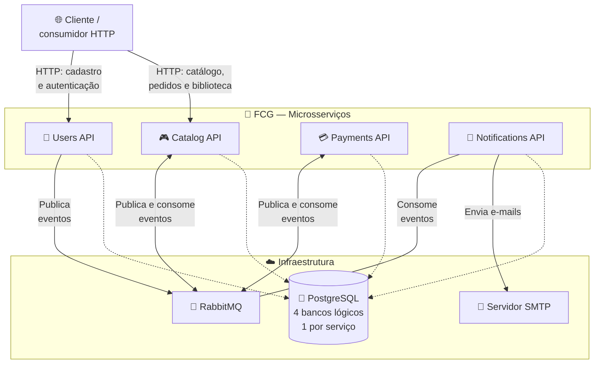
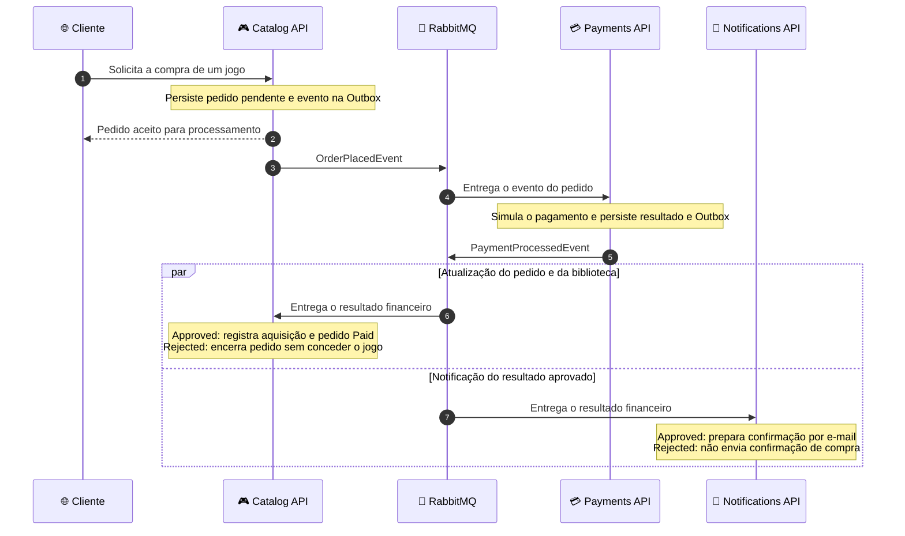

# 🎮 FIAP Cloud Games

### Plataforma de Jogos Digitais | Arquitetura de Microsserviços

**Tech Challenge — Pós-Tech FIAP | Arquitetura de Sistemas .NET**

Uma plataforma de aquisição de jogos digitais que conecta identidade, catálogo, pagamentos simulados e notificações por meio de microsserviços e eventos.

---

Este README apresenta o funcionamento e as decisões de arquitetura da solução. Os repositórios abaixo concentram a documentação técnica e as instruções de execução.

[Visão geral](#visão-geral) · [Repositórios](#repositórios) · [Arquitetura](#arquitetura) · [Jornadas](#jornadas-do-usuário) · [Eventos](#contratos-de-integração) · [Decisões](#decisões-arquiteturais) · [Tecnologias](#tecnologias) · [Qualidade](#qualidade-e-validação) · [Contexto acadêmico](#contexto-acadêmico)

## 📖 Visão geral

O **FIAP Cloud Games (FCG)** simula a jornada de aquisição de jogos: o usuário cria uma conta, consulta o catálogo, solicita uma compra e, após a aprovação de um pagamento simulado, tem o jogo registrado em sua biblioteca. Quatro microsserviços colaboram por APIs HTTP e eventos no RabbitMQ, com responsabilidades e dados próprios.

- **👤 Identidade:** cadastro, autenticação, perfis e manutenção dos dados dos usuários.
- **🎮 Catálogo e aquisições:** administração e consulta de jogos, pedidos de compra e biblioteca do usuário.
- **💳 Pagamentos:** simulação de aprovação ou rejeição e registro do resultado financeiro de cada pedido.
- **📧 Notificações:** e-mails de boas-vindas e confirmação de compras com pagamento aprovado.

A proposta acadêmica é demonstrar a organização de um sistema distribuído e seus desafios: comunicação entre serviços, autonomia de dados, consistência eventual e tratamento de falhas e duplicatas.

**Escopo funcional:** os pagamentos são simulados, sem cobrança financeira real. A biblioteca registra os jogos adquiridos; a solução não distribui nem executa os arquivos dos jogos.

## 📂 Repositórios

[Ver todos os repositórios da organização](https://github.com/orgs/FCG-FIAP-Cloud-Games/repositories).

| Repositório | Responsabilidade | Documentação técnica |
|---|---|---|
| [FCG.UsersAPI](https://github.com/FCG-FIAP-Cloud-Games/FCG.UsersAPI) | Contas, perfis, sessões, emissão de JWT e evento de cadastro. | [README do Users](https://github.com/FCG-FIAP-Cloud-Games/FCG.UsersAPI/blob/main/README.md) |
| [FCG.CatalogAPI](https://github.com/FCG-FIAP-Cloud-Games/FCG.CatalogAPI) | Jogos, pedidos, processamento do resultado de pagamento e biblioteca. | [README do Catalog](https://github.com/FCG-FIAP-Cloud-Games/FCG.CatalogAPI/blob/main/README.md) |
| [FCG.PaymentsAPI](https://github.com/FCG-FIAP-Cloud-Games/FCG.PaymentsAPI) | Pagamentos simulados, tentativas de processamento e publicação do resultado. | [README do Payments](https://github.com/FCG-FIAP-Cloud-Games/FCG.PaymentsAPI/blob/main/README.md) |
| [FCG.NotificationsAPI](https://github.com/FCG-FIAP-Cloud-Games/FCG.NotificationsAPI) | Consumo de eventos, projeção de e-mails dos usuários e envio de notificações. | [README do Notifications](https://github.com/FCG-FIAP-Cloud-Games/FCG.NotificationsAPI/blob/main/README.md) |
| [FCG-FIAP-Repo-Infra](https://github.com/FCG-FIAP-Cloud-Games/FCG-FIAP-Repo-Infra) | Ambiente integrado, dependências e implantação com Docker Compose e Kubernetes. | [README da infraestrutura](https://github.com/FCG-FIAP-Cloud-Games/FCG-FIAP-Repo-Infra/blob/main/README.md) |

> A branch `main` é a referência adotada pelo grupo para o projeto. Os links de documentação técnica apontam para essa branch. Versões de imagens, configurações e procedimentos de implantação pertencem à documentação de cada repositório.

## 🧩 Arquitetura

O cliente acessa Users para cadastro e autenticação e Catalog para consultar jogos, comprar e acompanhar sua biblioteca. A integração de negócio com Payments e Notifications utiliza eventos transportados pelo RabbitMQ.

As conexões pontilhadas representam persistência. **Cada serviço governa seu banco lógico**; no ambiente integrado, esses bancos compartilham uma instância PostgreSQL. Os serviços trocam informações por contratos, sem consultar diretamente os bancos uns dos outros.

Docker empacota os serviços e suas dependências. O repositório de infraestrutura reúne as definições de Docker Compose e os manifests Kubernetes. O envio de e-mails utiliza SMTP configurável; MailHog está disponível como alternativa de teste no ambiente fornecido pelo repositório Notifications.

## 🔄 Jornadas do usuário

### Cadastro e boas-vindas

1. O cliente solicita o cadastro ao **Users**.
2. Users persiste o usuário, a auditoria e a intenção de publicar `UserCreatedEvent` na mesma transação local.
3. Um processo em segundo plano publica o evento no RabbitMQ.
4. **Notifications** consome o evento, mantém uma cópia local do e-mail associada ao usuário e processa a mensagem de boas-vindas.

Essa cópia local permite que Notifications encontre o destinatário de futuras confirmações de compra sem consultar o banco do Users.

### Autenticação e permissões

Users autentica o usuário e emite um **JWT assinado com RS256**. O cliente apresenta esse token nas operações protegidas do Catalog, que valida sua assinatura com as chaves públicas do Users e aplica as permissões da operação.

A consulta ao catálogo é pública. A administração dos jogos exige perfil de administrador; pedidos e biblioteca estão associados ao usuário autenticado. A verificação do token no Catalog não exige consultar Users a cada requisição de negócio.

### Compra e biblioteca

O cliente solicita a compra de um jogo ao Catalog. O serviço utiliza o preço cadastrado, registra um pedido com estado `PendingPayment` e responde que a solicitação foi aceita para processamento. O resultado financeiro será recebido posteriormente por evento.

**Catalog é responsável por conceder o jogo; Payments é responsável pelo resultado financeiro.** Notifications recebe esse mesmo resultado em uma fila independente. Assim, o e-mail pode ser processado antes da atualização da biblioteca: sua chegada não comprova que a concessão já terminou.

## 🔗 Contratos de integração

Os eventos abaixo conectam os fluxos de negócio implementados. O RabbitMQ transporta as mensagens entre produtores e consumidores.

| Evento | Produtor | Consumidor | Efeito no fluxo |
|---|---|---|---|
| `UserCreatedEvent` | Users | Notifications | Alimenta a projeção local de e-mails e inicia as boas-vindas. |
| `OrderPlacedEvent` | Catalog | Payments | Solicita o processamento do pagamento de um pedido. |
| `PaymentProcessedEvent` | Payments | Catalog e Notifications, em filas independentes | Informa aprovação ou rejeição. Catalog atualiza pedido e biblioteca; Notifications trata a confirmação do resultado aprovado. |

Os contratos incluem identificadores de evento e correlação para relacionar as etapas de uma operação. Campos, versões e políticas de processamento são detalhados nos repositórios dos serviços.

## 🧭 Decisões arquiteturais

| Decisão | Aplicação e consequência |
|---|---|
| **Serviços por responsabilidade de negócio** | Identidade, catálogo/compras, pagamentos e notificações evoluem em projetos separados. A interoperabilidade depende dos contratos entre eles. |
| **Dados sob responsabilidade de cada serviço** | Cada serviço controla suas regras e persistência. Informações necessárias em outro domínio são propagadas por eventos, como o e-mail mantido pelo Notifications. |
| **Compra assíncrona e consistência eventual** | A aceitação do pedido antecede a conclusão do pagamento. Pedido, biblioteca e notificação podem refletir o resultado em momentos diferentes. |
| **Transações locais e Outbox** | Users, Catalog e Payments persistem a intenção de publicação junto à alteração de negócio. Um publicador envia as mensagens posteriormente e pode repetir uma publicação. |
| **Idempotência e Inbox** | Catalog reconhece repetições de solicitações de compra. Catalog e Payments registram o processamento de eventos para evitar efeitos duplicados; no Notifications, a persistência do envio depende do modo habilitado. |
| **Identidade com assinatura assimétrica** | Users mantém a chave privada de assinatura. Catalog utiliza material público para validar os tokens e aplicar suas próprias regras de acesso. |

Não existe uma única transação envolvendo os quatro serviços. A integração admite reentregas e combina persistência local, rastreabilidade e tratamento de duplicatas; isso não equivale a uma garantia de execução única de todos os efeitos externos.

## 💻 Tecnologias

| Função | Tecnologias |
|---|---|
| APIs e regras de negócio | C#, .NET 8 e ASP.NET Core |
| Persistência | PostgreSQL e Entity Framework Core |
| Transporte de eventos | RabbitMQ |
| Integração com mensageria | RabbitMQ.Client e MassTransit, conforme o serviço |
| Identidade e autorização | JWT com assinatura RS256; distribuição de chaves públicas por PEM ou JWKS |
| Empacotamento e ambientes | Docker e Docker Compose |
| Orquestração | Kubernetes |
| Notificações | SMTP; MailHog como opção para testes de e-mail |
| Código e colaboração | Git e GitHub |

## 🧪 Qualidade e validação

Os repositórios mantêm testes unitários e de integração. Conforme o serviço, os cenários cobrem regras de negócio, endpoints, autenticação, persistência, contratos de eventos, idempotência, concorrência e recuperação de falhas. Os requisitos e os procedimentos de execução ficam na documentação de cada projeto.

A existência dessas suítes não substitui a validação do ambiente integrado: serviços, configurações e versões de imagens precisam ser compatíveis para demonstrar a jornada completa.

### Estado das integrações

- **Cadastro, compra e resultado de pagamento:** os produtores e consumidores dos três eventos apresentados acima estão implementados nos serviços.
- **Entrega persistente de notificações:** Inbox, registro de intenções de envio e dispatcher SMTP estão implementados. O uso desse fluxo depende da ativação de `NotificationsDispatcher:Enabled` e da configuração correspondente; não deve ser presumido em todo ambiente.
- **Atualização de e-mail:** Notifications já possui consumidor para `UserEmailUpdatedEvent`, mas Users ainda não publica esse evento. O cadastro alimenta a projeção de e-mails; alterações posteriores no Users ainda não são propagadas automaticamente.
- **Confirmação por e-mail:** a aceitação da mensagem pelo servidor SMTP não comprova entrega na caixa postal, assim como a confirmação financeira não comprova conclusão da atualização da biblioteca.

## 🎓 Contexto acadêmico

O FIAP Cloud Games foi desenvolvido como parte do **Tech Challenge da Pós-Tech FIAP em Arquitetura de Sistemas .NET**.

O trabalho aplica conceitos de arquitetura de software e engenharia de sistemas distribuídos em um cenário de aquisição de jogos digitais. A organização em microsserviços permite demonstrar limites de domínio, comunicação assíncrona, autonomia de dados, segurança e tratamento de falhas, relacionando as decisões técnicas ao funcionamento do negócio.

### 👥 Integrantes

- **Matheus Henrique Matioli Dos Reis**
- **Carlos Henrique Lins Ponchirolli**
- **Leonardo Loss da Silva**
- **Gabriel Pinto Moura Lima**

---

**🎮 FIAP Cloud Games** 
Tech Challenge · Pós-Tech FIAP · Arquitetura de Sistemas .NET

