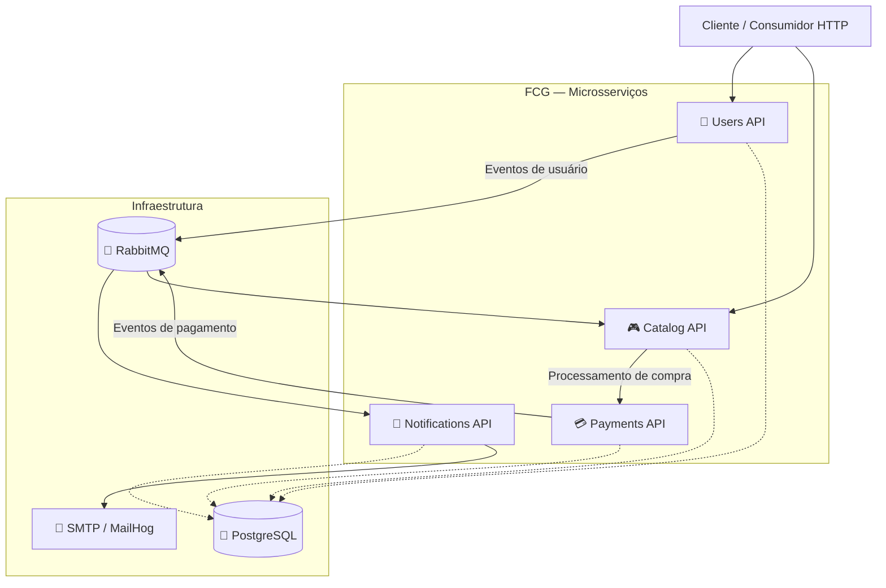

<div align="center">

# 🎮 FIAP Cloud Games

### Plataforma de Jogos Digitais | Arquitetura de Microsserviços

**Tech Challenge — Pós-Tech FIAP | Arquitetura de Sistemas .NET**

Uma plataforma de jogos digitais desenvolvida com foco em arquitetura de software, sistemas distribuídos, mensageria e boas práticas de engenharia.


</div>

---

## 📖 Sobre o projeto

O **FIAP Cloud Games (FCG)** é um projeto acadêmico desenvolvido durante a Pós-Tech em Arquitetura de Sistemas .NET da FIAP.

A plataforma simula um ecossistema de distribuição de jogos digitais, permitindo o gerenciamento de usuários, a consulta de jogos, a realização de compras, o processamento de pagamentos e o envio de notificações.

O projeto iniciou com uma abordagem de monólito modular e evoluiu para uma arquitetura baseada em **microsserviços independentes**.

Essa evolução tem como objetivo explorar desafios reais da engenharia de software, incluindo:

- Separação de responsabilidades e limites de domínio.
- Comunicação síncrona e assíncrona.
- Persistência e autonomia dos serviços.
- Consistência de dados em sistemas distribuídos.
- Idempotência e tratamento de mensagens duplicadas.
- Resiliência e recuperação de falhas.
- Conteinerização e integração entre serviços.

---

## 🏗️ Arquitetura

A solução é organizada em quatro microsserviços, cada um responsável por uma parte específica do negócio.



> O diagrama apresenta uma visão conceitual da arquitetura. Os detalhes de comunicação e os contratos devem ser consultados nos respectivos repositórios.

### Princípios arquiteturais

**Responsabilidade única**

Cada microsserviço concentra as operações relacionadas ao seu domínio de negócio.

**Baixo acoplamento**

A integração entre serviços prioriza contratos explícitos e comunicação orientada a eventos.

**Autonomia de dados**

Cada serviço possui responsabilidade sobre seus próprios dados e regras de persistência.

**Comunicação assíncrona**

O RabbitMQ permite propagar eventos de domínio e integração sem exigir chamadas HTTP diretas para todos os processos.

**Resiliência**

O projeto explora estratégias de idempotência, controle de concorrência e tratamento de falhas em operações distribuídas.

---

## 🧩 Microsserviços

### 👤 Users API

Responsável pelo gerenciamento de usuários e pela identidade da plataforma.

**Principais responsabilidades:**

- Cadastro de usuários.
- Autenticação e autorização.
- Emissão e validação de tokens JWT.
- Gerenciamento de informações cadastrais.
- Publicação de eventos relacionados aos usuários.

**Tecnologias:** ASP.NET Core, C#, PostgreSQL e integração com RabbitMQ.

---

### 🎮 Catalog API

Responsável pelo gerenciamento do catálogo de jogos e pelo ciclo de compra.

**Principais responsabilidades:**

- Cadastro e consulta de jogos.
- Gerenciamento do catálogo.
- Criação de pedidos de compra.
- Controle dos estados dos pedidos.
- Registro de aquisições.
- Consulta à biblioteca de jogos do usuário.
- Processamento dos resultados de pagamento.

O serviço concentra a responsabilidade sobre o pedido e a concessão de jogos após a confirmação do pagamento.

---

### 💳 Payments API

Responsável pelo processamento financeiro das compras.

**Principais responsabilidades:**

- Recebimento de solicitações de pagamento.
- Simulação de processamento financeiro.
- Controle do resultado do pagamento.
- Publicação de eventos de aprovação ou rejeição.
- Integração assíncrona com os demais microsserviços.

O serviço é responsável pelo pagamento, enquanto a gestão do pedido e a aquisição do jogo permanecem sob responsabilidade do catálogo.

---

### 📧 Notifications API

Responsável pelo processamento de notificações da plataforma.

**Principais responsabilidades:**

- Consumo de eventos de usuários.
- Envio de e-mails de boas-vindas.
- Processamento de notificações de compra.
- Integração com servidores SMTP.
- Suporte a testes de e-mail utilizando MailHog.
- Persistência de notificações e controle de entregas.

A API também está evoluindo para uma estratégia de entrega persistente, com:

- Inbox transacional.
- Deduplicação de eventos.
- Controle de concorrência.
- Estados de processamento das notificações.
- Dispatcher SMTP persistente.
- Tratamento de resultados incertos de entrega.

**Status:** a infraestrutura persistente está implementada, mas sua habilitação global depende da conclusão da integração dos consumidores restantes.

---

## 🔄 Comunicação entre microsserviços

A arquitetura utiliza dois modelos de comunicação.

### Comunicação síncrona — HTTP

Utilizada para operações que exigem resposta imediata, como autenticação, consulta ao catálogo e criação de pedidos.

### Comunicação assíncrona — RabbitMQ

Utilizada para distribuir eventos entre os serviços.

Exemplos de eventos:

| Evento | Finalidade |
|---|---|
| `UserCreatedEvent` | Notificar a criação de um usuário. |
| `UserEmailUpdatedEvent` | Propagar atualizações de e-mail. |
| `PaymentProcessedEvent` | Comunicar o resultado de um pagamento. |
| `PurchaseNotificationTestEvent` | Permitir testes do fluxo de notificações de compra. |

A comunicação orientada a eventos reduz o acoplamento temporal entre os serviços e permite o processamento independente de determinadas operações.

---

## 🛠️ Stack tecnológica

| Categoria | Tecnologia |
|---|---|
| Linguagem | C# |
| Framework | ASP.NET Core / .NET 8 |
| Persistência | PostgreSQL |
| ORM | Entity Framework Core |
| Mensageria | RabbitMQ |
| Integração de eventos | MassTransit |
| Autenticação | JWT |
| Conteinerização | Docker |
| Orquestração local | Docker Compose |
| Testes de e-mail | MailHog |
| E-mail | SMTP |
| Versionamento | Git / GitHub |

---

## 🐳 Ambiente de desenvolvimento

Os microsserviços podem ser executados de forma integrada utilizando Docker Compose.

O ambiente contempla:

- Quatro APIs independentes.
- PostgreSQL.
- RabbitMQ.
- MailHog para testes de notificações.
- Redes Docker para comunicação entre containers.

### Portas locais da demonstração

| Serviço | Porta |
|---|---|
| Users API | `5088` |
| Catalog API | `5081` |
| Payments API | `5082` |
| Notifications API | `5083` |

As portas podem variar conforme a configuração do ambiente.

### Executando o ambiente

A partir do diretório que contém o arquivo `docker-compose.yml` integrado:

```bash
docker compose up -d
```

Verifique os containers:

```bash
docker compose ps
```

Consulte os logs de um serviço específico:

```bash
docker compose logs -f notificationsapi
```

A documentação de cada repositório contém as configurações específicas necessárias para executar seu serviço.

> **Segurança:** não publique credenciais SMTP, senhas, chaves JWT ou arquivos `.env` contendo informações sensíveis.

---

## 🧪 Testes e qualidade

O projeto utiliza testes unitários e de integração para validar comportamentos de negócio e componentes de infraestrutura.

Entre os cenários trabalhados estão:

- Validação de regras de domínio.
- Funcionamento dos endpoints.
- Persistência de dados.
- Processamento de eventos.
- Idempotência.
- Concorrência.
- Rollback transacional.
- Tratamento de falhas.
- Integração com PostgreSQL.

A cobertura e os requisitos de execução dos testes variam conforme o microsserviço.

---

## 📈 Evolução arquitetural

O FIAP Cloud Games é um projeto em evolução contínua.

### Etapas de evolução

- [x] Desenvolvimento da aplicação inicial.
- [x] Organização em módulos de domínio.
- [x] Definição das responsabilidades dos microsserviços.
- [x] Separação dos serviços de usuários, catálogo, pagamentos e notificações.
- [x] Integração utilizando RabbitMQ.
- [x] Conteinerização com Docker.
- [x] Execução integrada com Docker Compose.
- [ ] Consolidação da idempotência dos fluxos de notificação.
- [ ] Ampliação dos testes funcionais entre serviços.
- [ ] Evolução de observabilidade e resiliência distribuída.

> Os itens representam a evolução geral do projeto, não necessariamente o estado de conclusão de todos os requisitos de cada serviço.

---

## 📂 Organização dos repositórios

O projeto é dividido em repositórios independentes para facilitar a manutenção e a evolução dos microsserviços.

| Repositório | Domínio |
|---|---|
| **Users API** | Identidade e usuários |
| **Catalog API** | Jogos, pedidos e biblioteca |
| **Payments API** | Processamento de pagamentos |
| **Notifications API** | Eventos e notificações |

Acesse a aba **Repositories** desta organização para explorar os projetos.

---

## 🎓 Contexto acadêmico

Este projeto foi desenvolvido como parte do **Tech Challenge da Pós-Tech FIAP em Arquitetura de Sistemas .NET**.

O objetivo é aplicar conceitos de engenharia e arquitetura de software em um cenário que simula desafios encontrados no desenvolvimento de sistemas reais.

O projeto busca demonstrar não apenas a implementação de funcionalidades, mas também o processo de evolução arquitetural, a tomada de decisões técnicas e o tratamento de problemas característicos de sistemas distribuídos.

---

<div align="center">

### 🎮 FIAP Cloud Games

**Aprendendo arquitetura através da construção de sistemas distribuídos.**

Desenvolvido com C#, .NET, PostgreSQL, RabbitMQ e Docker.

**Tech Challenge | Pós-Tech FIAP**

</div>